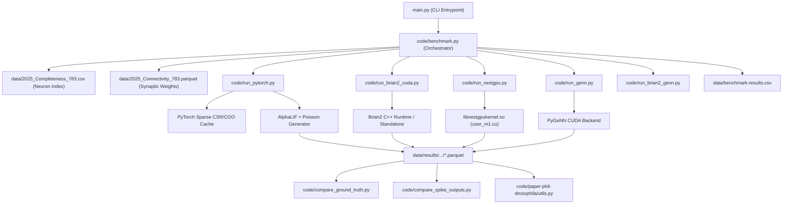
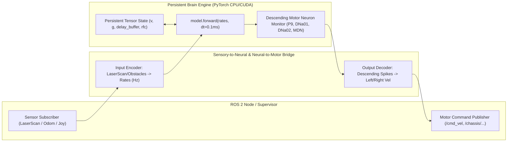

# Fly Brain Dependency and Execution Flow Map

## 1. System Dependency Hierarchy

---

## 2. Program Execution Flow (Step-by-Step)

### Step 1: Configuration & CLI Parsing
- `main.py` parses arguments: simulation time `--t_run` (in seconds: 0.1, 1.0, 10.0, 100.0), trial count `--n_run` (1, 4, 8, 16, 32), experiment selector `--experiment` (`sugar` or `p9`), and backend selection flags.
- `main.py` invokes `benchmark.run_benchmarks()`.

### Step 2: Biological Connectome Loading & Index Mapping
1. **Completeness Materialization (`2025_Completeness_783.csv`)**:
   - Contains 138,639 biological neurons identified by FlyWire IDs (64-bit integer, e.g., `720575940627652358`).
   - Mapped into a dense 0-based integer tensor index:
     - `flyid2i: FlyWire_ID -> [0 .. 138,638]`
     - `i2flyid: [0 .. 138,638] -> FlyWire_ID`
2. **Connectivity Graph (`2025_Connectivity_783.parquet`)**:
   - Contains ~5 million directed synaptic connections.
   - Columns:
     - `Presynaptic_Index`: source neuron dense index $i \in [0 .. 138638]$
     - `Postsynaptic_Index`: target neuron dense index $j \in [0 .. 138638]$
     - `Excitatory x Connectivity`: signed integer count (+ for excitatory, - for inhibitory) representing synapse count.
3. **Sparse Matrix Construction**:
   - PyTorch constructs a sparse CSR/COO tensor:
     $$W_{j, i} = \text{Count} \times w_{syn}$$
     where $w_{syn} = 0.275 \text{ mV}$. Caches to `weight_coo.pkl` and `weight_csr.pkl`.

### Step 3: Neural Model Construction & State Initialization
At simulation start, the dynamic state variables for all 138,639 neurons are allocated:

| State Variable | Dimension (PyTorch) | Initial Value | Units | Biological Meaning |
|---|---|---|---|---|
| Membrane Potential ($v$) | `(batch, 138639)` | $v_0 = -52.0$ | mV | Resting electrical potential of somatic membrane |
| Synaptic Conductance ($g$) | `(batch, 138639)` | $0.0$ | mV | Postsynaptic conductance driving membrane integration |
| Spike Output ($S$) | `(batch, 138639)` | $0.0$ | $\{0, 1\}$ | Binary spike indicator at current timestep |
| Refractory Counter ($rfc$) | `(batch, 138639)` | $0$ (or initial) | steps | Discrete steps remaining in absolute refractory period |
| Synaptic Delay Buffer | `(batch, steps_delay + 1, 138639)` | $0.0$ | mV | FIFO ring buffer implementing axonal/synaptic transmission delay ($t_{dly} = 1.8 \text{ ms} = 18 \text{ steps}$) |

### Step 4: Discrete Integration Loop (Timestep $\Delta t = 0.1\text{ ms}$)
For each timestep $k = 1 .. T$:
1. **Sensory / External Drive (Poisson Generation)**:
   - For stimulated neurons (e.g. $i \in \text{exc\_indices}$), Poisson rate $r_i$ (e.g. 100 Hz or 200 Hz).
   - Bernoulli trial probability: $p_i = r_i \times \frac{\Delta t}{1000} = r_i \times 10^{-4}$.
   - Poisson spike impulse: $V_{stim} = 0.275 \text{ mV} \times 250 \times \text{Bernoulli}(p_i)$.
2. **Recurrent Synaptic Transmission**:
   - Delayed spikes from buffer arrive:
     $$I_{syn} = w_{scale} \sum_{j} W_{i, j} S_j(t - t_{dly})$$
     Implemented as sparse matrix-vector multiplication: `recurrent_input = scale * torch.matmul(spikes, weights.T)`.
3. **Synaptic Conductance Decay**:
   $$g(t + \Delta t) = g(t) \times \left(1 - \frac{\Delta t}{\tau_{syn}}\right) + I_{syn}$$
   where $\tau_{syn} = 5.0\text{ ms}$.
4. **Membrane Potential Leaky Integration**:
   - If neuron is refractory ($rfc > 0$), $v$ is held at $v_{reset} = -52\text{ mV}$.
   - Otherwise:
     $$v(t + \Delta t) = v(t) + V_{stim} + \frac{\Delta t}{\tau_{mem}} \left(g(t) - (v(t) - v_{rest})\right)$$
     where $\tau_{mem} = 20.0\text{ ms}$, $v_{rest} = -52.0\text{ mV}$.
5. **Threshold Crossing & Spike Generation**:
   - Spike condition: if $v(t + \Delta t) \ge v_{th} = -45.0\text{ mV}$:
     - Emit spike: $S_i(t + \Delta t) = 1$
     - Reset membrane: $v(t + \Delta t) \leftarrow v_{reset} = -52.0\text{ mV}$
     - Reset conductance: $g(t + \Delta t) \leftarrow 0$
     - Set refractory steps: $rfc_i \leftarrow \text{round}(t_{rfc}/\Delta t) = 22 \text{ steps}$ ($2.2\text{ ms}$)
   - If neuron was an external Poisson target, $rfc_i$ is clamped to 0 so external stimulation can sustain high firing rates.

### Step 5: Spike Extraction & Recording
- Active spikes ($S_i == 1$) are filtered.
- Timestep $k$, trial index, neuron index, and mapped biological FlyWire ID are accumulated.
- Exported to Parquet format upon simulation completion.

---

## 3. Dependency Map for ROS 2 Closed-Loop Integration

### Module Calling Matrix

| Module | Called By | Calls | Runtime / Bench / Analysis | ROS 2 Relevance |
|---|---|---|---|---|
| `main.py` | CLI user / script | `code.benchmark` | Benchmark CLI | Wrapper reference only |
| `code/benchmark.py` | `main.py` | `run_pytorch`, `run_brian2_cuda`, etc. | Orchestration | Configuration & Experiment reference |
| `code/run_pytorch.py` | `code/benchmark.py` | PyTorch, `2025_*.parquet`, `2025_*.csv` | Runtime Engine | **Direct core for ROS 2 Brain Runtime** |
| `code/run_brian2_cuda.py` | `code/benchmark.py` | Brian2, Brian2CUDA | Runtime Engine | Biological ground truth reference |
| `code/run_nestgpu.py` | `code/benchmark.py` | NEST GPU | Runtime Engine | Incompatible (no in-process step) |
| `code/run_genn.py` | `code/benchmark.py` | PyGeNN | Runtime Engine | Requires NVIDIA GPU |
| `code/paper-phil-drosophila/model.py` | `example.ipynb`, `figures.ipynb` | Brian2 | Reference Library | Biological parameter definitions |
| `code/paper-phil-drosophila/utils.py` | `example.ipynb`, `figures.ipynb` | pandas, numpy | Analysis | Rate calculation reference |
