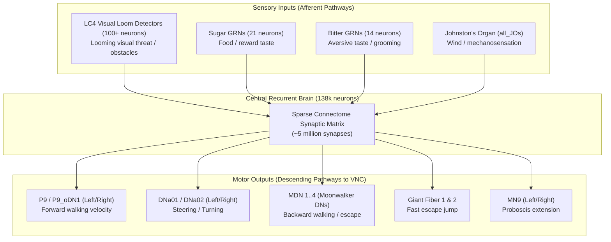

# Fly Brain Neural Model, Scientific Scope, and Learning Evaluation

## 1. Connectome Structure and Synaptic Representation

### 1.1 Connectome Origin and Versioning
The neural architecture is derived from the **FlyWire whole-brain connectome** of the adult fruit fly (*Drosophila melanogaster*):
- **Version**: Public Release Version **783** (`2025_Completeness_783.csv` and `2025_Connectivity_783.parquet`).
- **Scale**:
  - $N = 138,639$ reconstructed neurons spanning the entire central brain (excluding the optic lobes' peripheral photoreceptors and the ventral nerve cord / VNC).
  - Approximately $5,000,000$ directed synaptic connections.
- **Legacy Version**: Version **630** (`data/archive/2023_*_630.*`), containing 127,978 neurons and ~4.3M synapses, used in earlier preprints by Shiu et al. (2023).

### 1.2 Neuron Indexing and Hash Mappings
Neuron identity is managed via a two-level indexing scheme:
1. **FlyWire Biological ID**: 64-bit globally unique identifier assigned during EM reconstruction (e.g. `720575940627652358`).
2. **Dense Matrix Index**: Zero-based integer $i \in [0, N-1]$ corresponding to the row order in `2025_Completeness_783.csv`.

The mapping functions (`get_hash_tables()` in `code/run_pytorch.py` and `code/benchmark.py`) provide bidirectional lookup:
$$\text{flyid2i}: \text{FlyWire ID} \to \{0, \dots, N-1\}$$
$$\text{i2flyid}: \{0, \dots, N-1\} \to \text{FlyWire ID}$$

### 1.3 Synaptic Connectivity, Weights, and Delays
Each record in `2025_Connectivity_783.parquet` defines a directed edge $(i, j)$:
- `Presynaptic_Index`: Dense source neuron index $i$.
- `Postsynaptic_Index`: Dense target neuron index $j$.
- `Excitatory x Connectivity`: An integer count $C_{ij}$ representing the number of anatomical synapse contact points, with sign indicating neurotransmitter phenotype:
  - Positive ($+C_{ij}$): Excitatory (cholinergic).
  - Negative ($-C_{ij}$): Inhibitory (GABAergic / glutamatergic).

The effective synaptic weight $W_{ij}$ is scaled by the single free parameter $w_{syn}$:
$$W_{ij} = C_{ij} \times w_{syn}$$
where $w_{syn} = 0.275 \text{ mV}$.

Transmission delays are uniform across all chemical synapses:
$$t_{dly} = 1.8 \text{ ms}$$
(based on physiological measurements from Paul et al., 2015).

---

## 2. Mathematical Neuron Dynamics (Shiu et al. LIF Model)

The biological simulation implements a Leaky Integrate-and-Fire (LIF) model coupled to an alpha-function synaptic conductance filter.

### 2.1 Differential Equations
For each neuron $i$, the state is governed by two coupled variables:
1. **Membrane Potential $v_i(t)$**:
   $$\tau_{mbr} \frac{dv_i(t)}{dt} = v_0 - v_i(t) + g_i(t) \quad (\text{for } t > t_{spk} + t_{rfc})$$
2. **Synaptic Conductance $g_i(t)$**:
   $$\tau_{syn} \frac{dg_i(t)}{dt} = -g_i(t) \quad (\text{for } t > t_{spk} + t_{rfc})$$

### 2.2 Numerical Parameters

| Parameter | Symbol | Value | Unit | Biological Source Reference |
|---|---|---|---|---|
| Resting Potential | $v_0$ | $-52.0$ | mV | Kakaria & de Bivort (2017) |
| Reset Potential | $v_{rst}$ | $-52.0$ | mV | Kakaria & de Bivort (2017) |
| Threshold Potential | $v_{th}$ | $-45.0$ | mV | Kakaria & de Bivort (2017) |
| Membrane Time Constant | $\tau_{mbr}$ | $20.0$ | ms | $C_m \times R_m = 0.002\,\mu\text{F} \times 10\,\text{M}\Omega$ |
| Synaptic Time Constant | $\tau_{syn}$ | $5.0$ | ms | Jürgensen et al. (2021) |
| Refractory Period | $t_{rfc}$ | $2.2$ | ms | Lazar et al. (2020) |
| Synaptic Delay | $t_{dly}$ | $1.8$ | ms | Paul et al. (2015) |
| Synaptic Scale Factor | $w_{syn}$ | $0.275$ | mV | Shiu et al. (2024) fit |
| Simulation Timestep | $\Delta t$ | $0.1$ | ms | Standard discretization ($10,000 \text{ Hz}$) |

### 2.3 Discrete Integration Scheme (Euler Step)
At each discrete timestep $k$ ($t = k \Delta t$):
1. **Recurrent Synaptic Input Arrival**:
   $$I_{syn, i}[k] = w_{syn} \sum_{j=1}^N C_{ji} \cdot S_j[k - d]$$
   where $d = \text{round}(t_{dly}/\Delta t) = 18$ discrete steps, and $S_j \in \{0, 1\}$ is the spike indicator.
2. **Conductance Update**:
   $$g_i[k] = g_i[k-1] \left(1 - \frac{\Delta t}{\tau_{syn}}\right) + I_{syn, i}[k]$$
3. **Membrane Potential Update**:
   $$v_i[k] = v_i[k-1] + V_{stim, i}[k] + \frac{\Delta t}{\tau_{mbr}} \left(g_i[k-1] - (v_i[k-1] - v_0)\right)$$
4. **Spike Generation and Reset**:
   $$\text{If } v_i[k] \ge v_{th} \implies \begin{cases} S_i[k] = 1 \\ v_i[k] \leftarrow v_{rst} = -52.0\text{ mV} \\ g_i[k] \leftarrow 0 \\ rfc_i \leftarrow \text{round}(t_{rfc}/\Delta t) = 22\text{ steps} \end{cases}$$
   While $rfc_i > 0$, the neuron is in an absolute refractory state: $v_i$ is clamped to $v_{rst}$, and incoming conductance updates are ignored.

---

## 3. Neural Stimulation and Silencing

### 3.1 Neural Activation (Optogenetic Drive)
Target neurons are driven by external Poisson spike trains emulating channelrhodopsin photostimulation:
- **Stimulation Mechanism**: A Poisson process generates spikes with mean arrival rate $r_{poi}$ (typically $100 \text{ Hz}$ to $200 \text{ Hz}$).
- **Voltage Injection**: Each Poisson event injects an instantaneous depolarizing voltage step:
  $$V_{stim} = w_{syn} \times f_{poi}$$
  where $f_{poi} = 250$. Thus:
  $$V_{stim} = 0.275 \text{ mV} \times 250 = 68.75 \text{ mV}$$
  Because $V_{stim} > (v_{th} - v_0) = 7.0 \text{ mV}$, every arriving Poisson event immediately forces the target neuron across threshold.
- **Refractory Clamping**: In stimulated neurons, the refractory period is set to $rfc = 0 \text{ ms}$ (`neu[i].rfc = 0 * ms`). This allows the target neuron to faithfully reproduce the Poisson stimulation frequency up to several hundred Hertz without being blocked by intrinsic refractory limits.

### 3.2 Neural Silencing (Optogenetic Inhibition)
Silencing emulates optogenetic hyperpolarization or synaptic arrest (e.g. via GtACR1 or halorhodopsin):
- **Implementation**: The simulator sets all outgoing synaptic weights from the silenced neuron population to zero:
  $$\forall j, \quad W_{i \to j} = 0 \quad (\text{for } i \in \text{neu\_slnc})$$
  In NEST GPU's kernel, silencing also prevents spike dispatch (`if (!slnc_on) PushSpike(...)`).
- **Effect**: Silenced neurons may still fluctuate internally if stimulated, but they cannot transmit spikes or excite/inhibit any downstream neurons in the brain network.

---

## 4. Identified Sensory and Motor Pathways

From the connectome metadata and `code/paper-phil-drosophila/example.ipynb`, biologically grounded pathways have been identified and mapped to specific FlyWire IDs:

### 4.1 Identified Biological Neurons

| Pathway / Modality | FlyWire ID | Anatomical / Functional Name | Biological Role & Evidence | Confidence |
|---|---|---|---|---|
| **Forward Locomotion** | `720575940627652358` | `P9_left` | Pre-descending interneuron promoting forward walking (Bidaye et al., 2020) | High |
| **Forward Locomotion** | `720575940635872101` | `P9_right` | Pre-descending interneuron promoting forward walking | High |
| **Forward Velocity** | `720575940626730883` | `P9_oDN1_left` | Descending neuron driving forward velocity to ventral nerve cord | High |
| **Forward Velocity** | `720575940620300308` | `P9_oDN1_right` | Descending neuron driving forward velocity to ventral nerve cord | High |
| **Steering / Turning** | `720575940644438551` | `DNa01_left` | Descending neuron for steering/turning (Rayshubskiy et al., 2020) | High |
| **Steering / Turning** | `720575940627787609` | `DNa01_right` | Descending neuron for steering/turning | High |
| **Steering / Turning** | `720575940604737708` | `DNa02_left` | Descending neuron for steering/turning | High |
| **Steering / Turning** | `720575940629327659` | `DNa02_right` | Descending neuron for steering/turning | High |
| **Backward Walking** | `720575940616026939` | `MDN_1` | Moonwalker descending neuron; triggers backward walking (Bidaye et al., 2014) | High |
| **Backward Walking** | `720575940631082808` | `MDN_2` | Moonwalker descending neuron | High |
| **Backward Walking** | `720575940640331472` | `MDN_3` | Moonwalker descending neuron | High |
| **Backward Walking** | `720575940610236514` | `MDN_4` | Moonwalker descending neuron | High |
| **Escape Response** | `720575940622838154` | `Giant_Fiber_1` | Giant Fiber neuron driving jump/takeoff escape (Allen et al., 2006) | High |
| **Escape Response** | `720575940632499757` | `Giant_Fiber_2` | Giant Fiber neuron driving jump/takeoff escape | High |
| **Visual Loom / Obstacle** | `720575940605598892` et al. (104 IDs) | `LC4` population | Lobula Columellar type 4; responds selectively to visual looming stimuli (Ache et al., 2019) | High |
| **Gustatory (Sugar)** | `720575940624963786` et al. (21 IDs) | Sugar GRNs | Gustatory receptor neurons in proboscis responding to sucrose | High |
| **Gustatory (Bitter)** | `720575940619072513` et al. (14 IDs) | Bitter GRNs | Gustatory receptor neurons responding to aversive compounds | High |

---

## 5. Investigation: What Does "Training" Actually Mean Here?

A comprehensive audit of the entire codebase was conducted to determine whether learning or training mechanisms exist.

### 5.1 Verification Matrix

| Mechanism | Present in Code? | Evidence / File Reference | Findings |
|---|---|---|---|
| **Synaptic Plasticity** | **NO** | `code/run_pytorch.py`, `code/run_brian2_cuda.py` | Synaptic weights $W_{ij}$ are completely static throughout simulation. No weight updates occur. |
| **STDP (Spike-Timing Dependent Plasticity)** | **NO** | Entire repository | Zero occurrences of STDP equations or eligibility traces. |
| **Reinforcement Learning** | **NO** | Entire repository | No policy networks, reward functions, value networks, or replay buffers. |
| **Reward / Punishment Signals** | **NO** | Entire repository | Dopaminergic modulation is not dynamically modeled; only static anatomy is loaded. |
| **Optimizers / Loss Functions** | **NO** | `code/run_pytorch.py` | PyTorch runs strictly under `with torch.no_grad():`. No `torch.optim`, loss functions, or parameter updates exist. |
| **Trainable Parameters** | **NO** | `TorchModel` | All weights are registered as fixed buffers; no `nn.Parameter` exists. |
| **Surrogate Gradient Stub** | **Partial (Unused)** | `code/run_pytorch.py:132-145` | An `ATan` autograd function is defined: `def backward(ctx, grad_output): return 1/(1+(pi*v)^2) * grad_output`. However, `loss.backward()` is **never called anywhere** in the codebase. It is an unused experimental stub. |
| **Checkpointing / Learned State** | **NO** | Entire repository | Only static precomputed sparse matrices (`weight_coo.pkl`, `weight_csr.pkl`) and benchmark output parquet files are saved. |

### 5.2 Clarifying the Terminology
We must clearly categorize the different senses of "running" vs "training":

- **Possibility A: Running a neural simulation** $\implies$ **YES, FULLY IMPLEMENTED**.
  The code numerically integrates LIF differential equations across the static 138k FlyWire connectome.
- **Possibility B: Experimentally changing activity through stimulation & silencing** $\implies$ **YES, FULLY IMPLEMENTED**.
  External Poisson drive depolarizes specific neurons, and silencing clamps outgoing synapses to zero.
- **Possibility C: Optimizing external stimulation parameters** $\implies$ **NOT IMPLEMENTED IN REPO** (User script can perform grid search).
- **Possibility D: Training a separate controller or policy around the brain** $\implies$ **NOT IMPLEMENTED IN REPO** (Must be built in the integration layer).
- **Possibility E: Learning through synaptic weight updates in the biological connectome** $\implies$ **COMPLETELY ABSENT**.

> [!IMPORTANT]
> The fruit-fly brain model in this repository is an **un-trained, static, non-plastic computational biophysical emulation**. It does not learn, adapt, or update synaptic weights during execution. Any adaptive or closed-loop robot control must either rely on the innate hardwired connectivity discovered in the connectome (e.g. LC4 loom $\to$ MDN/P9 $\to$ DNa steering) or utilize an external trainable decoding policy.

---

## 6. Evaluation of Consciousness and Autonomous Agency Claims

Scientific evaluation of claims regarding "bringing the fly brain to life" or "consciousness in a virtual world":

1. **What the Code Is**:
   - A numerical differential equation solver for a frozen graph of 138,639 leaky integrate-and-fire nodes and 5 million static edges.
   - It computes membrane voltages ($v$) and binary spike events ($S \in \{0, 1\}$) using discrete forward Euler steps ($\Delta t = 0.1\text{ ms}$).
2. **What the Code Lacks**:
   - No body or sensory organs (all inputs are manually specified Poisson frequencies).
   - No biophysical neuromodulation (serotonin, dopamine, octopamine do not dynamically modulate excitability or plasticity).
   - No homeostatic regulation or metabolic constraints.
   - No learning, memory formation, or synaptic modification.
   - No autonomous goal generation or subjective awareness.
3. **Scientific Conclusion**:
   Equating 138k LIF equations or large connectome graphs with "consciousness" is scientifically unfounded. The model is a valuable tool for **computational neuroanatomy and feedforward/recurrent network dynamics**, and can serve as an **innate biological pattern generator and sensorimotor filter** for robotics research, but it is not a conscious or self-directed entity.
