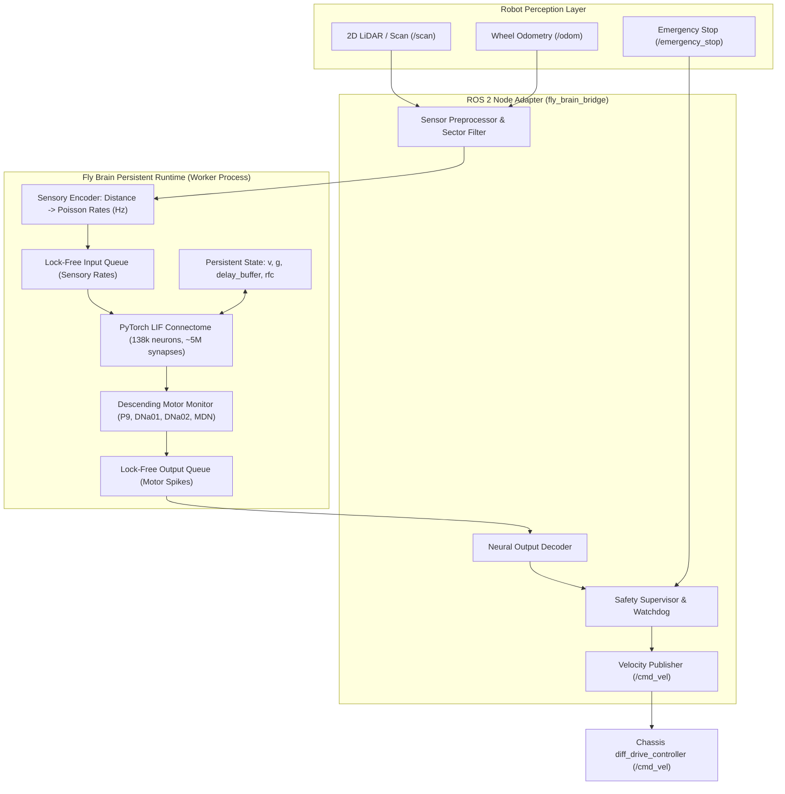
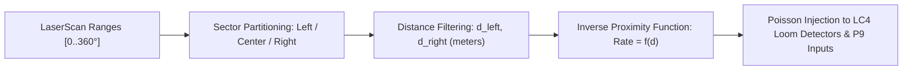

# Fly Brain ROS 2 Architecture for Autonomous Four-Wheel Robot

## 1. System Context & Robotic Hardware Target

The intended robot is a **four-wheel, non-steered differential / skid-steer autonomous ground vehicle**, directly aligned with the chassis and hardware interface packages located on this system (`/home/om/Desktop/ros2-chassis`):
- **Base Footprint & Coordinate Frame**: `base_footprint` $\to$ `base_link` $\to$ `wheel_left_link`, `wheel_right_link`, `laser_link`, `imu_link`.
- **Kinematic Parameters**:
  - Track Width (Wheel Separation $B$): $0.36\text{ m}$
  - Wheel Radius ($r$): $0.085\text{ m}$
- **Controller Interface**: `diff_drive_controller` from `ros2_control`, subscribing to `geometry_msgs/msg/Twist` on topic `/cmd_vel` (or routed through `twist_mux`).
- **Wheel Kinematics**:
  $$v_L = v_x - \frac{\omega_z \cdot B}{2}, \quad v_R = v_x + \frac{\omega_z \cdot B}{2}$$

---

## 2. Architecture Overview

---

## 3. Layer Breakdown and Responsibilities

### 3.1 Sensory Encoding Layer
The biological connectome cannot process raw ROS 2 messages (`sensor_msgs/msg/LaserScan`) directly. The sensory encoding layer translates physical distances into biological Poisson spike rates:

- **Left Obstacle Sector ($[-45^\circ, +15^\circ]$)**: Encoded into Left LC4 Loom visual projection neurons (`720575940605598892` etc.).
- **Right Obstacle Sector ($[-15^\circ, +45^\circ]$)**: Encoded into Right LC4 Loom visual projection neurons.
- **Clear Path Forward**: Feeds excitatory drive ($100\text{ Hz}$) to forward locomotion drivers `P9_left` and `P9_right`.
- **Proximity Mapping Equation**:
  $$r_{loom}(d) = r_{max} \cdot \text{clamp}\left(1.0 - \frac{d - d_{min}}{d_{detect} - d_{min}}, 0.0, 1.0\right)$$
  where $d_{detect} = 1.5\text{ m}$, $d_{min} = 0.3\text{ m}$, and $r_{max} = 200\text{ Hz}$.

### 3.2 Persistent Fly-Brain Runtime
- Executes as an isolated, persistent worker process using the verified PyTorch CPU engine.
- Maintains the $138,639$-neuron state in memory without garbage-collection churn or re-allocation.
- Advances in discrete time steps of $\Delta t = 0.1\text{ ms}$.
- Accepts updated sensory stimulation rates asynchronously via inter-process queues or thread-safe shared arrays.
- Emits binary spikes for monitored descending pathways.

### 3.3 Neural Output Decoder
Translates high-dimensional spike trains into 2-DOF chassis control ($v_x, \omega_z$):
- **Descending Populations Monitored**:
  - `P9_oDN1_left` (`720575940626730883`) & `P9_oDN1_right` (`720575940620300308`) $\implies$ Forward walking command.
  - `DNa01_left` (`720575940644438551`) & `DNa02_left` (`720575940604737708`) $\implies$ Turn right steering command.
  - `DNa01_right` (`720575940627787609`) & `DNa02_right` (`720575940629327659`) $\implies$ Turn left steering command.
  - `MDN_1`..`MDN_4` (`720575940616026939` etc.) $\implies$ Backward / retreat command.
- **Decoding Equation (Sliding Window $W = 100\text{ ms}$)**:
  $$v_{fwd} = k_v \cdot \frac{N_{P9\_oDN1}(W)}{W}$$
  $$v_{rev} = k_{rev} \cdot \frac{N_{MDN}(W)}{W}$$
  $$v_x = v_{fwd} - v_{rev}$$
  $$\omega_z = k_\omega \cdot \frac{N_{DNa\_Right}(W) - N_{DNa\_Left}(W)}{W}$$

### 3.4 Safety Supervisor
Acts as a fail-safe firewall between the biological neural model and the physical/simulated chassis:
1. **Startup Inactivity**: Ensures zero velocity command until brain initialization and sensor heartbeats are established.
2. **Watchdog Timeout**: If the neural worker process crashes or the latency exceeds $0.5\text{ s}$, publishes an immediate zero-velocity halt (`0.0 m/s, 0.0 rad/s`).
3. **Hard Obstacle Override**: If LiDAR detects an obstacle closer than $d_{stop} = 0.25\text{ m}$, the safety supervisor immediately commands a halt and backward creep, overriding neural commands.
4. **Command Saturation**: Clamps linear acceleration ($a_{max} = 1.0\text{ m/s}^2$), maximum speed ($v_{max} = 0.5\text{ m/s}$), and yaw rate ($\omega_{max} = 1.5\text{ rad/s}$).
5. **Emergency Stop Topic**: Immediate asynchronous halt on receipt of `/emergency_stop` `True`.
