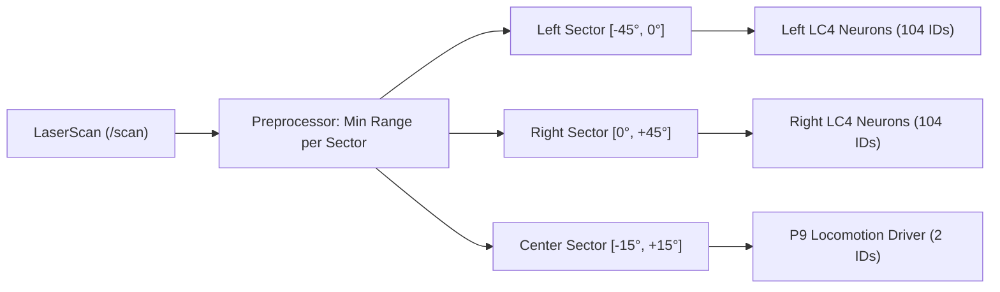

# Fly Brain ROS 2 Interface Contract

## 1. Topic Specifications

| Topic Name | Direction | Message Type | Rate (Hz) | QoS Profile | Description |
|---|---|---|---|---|---|
| `/scan` | Input | `sensor_msgs/msg/LaserScan` | $10 - 20\text{ Hz}$ | SensorData (Best Effort / Volatile) | 2D LiDAR range scan from robot front laser scanner. |
| `/odom` | Input | `nav_msgs/msg/Odometry` | $20 - 50\text{ Hz}$ | Reliable / Transient Local | Wheel odometry from `diff_drive_controller`. |
| `/emergency_stop` | Input | `std_msgs/msg/Bool` | Event-driven | Reliable / Transient Local | Hardware / software emergency stop trigger. |
| `/cmd_vel` | Output | `geometry_msgs/msg/Twist` | $20\text{ Hz}$ | Reliable / Volatile | Linear and angular velocity command to differential drive chassis. |
| `/fly_brain/status` | Output | `std_msgs/msg/String` | $1\text{ Hz}$ | Reliable / Transient Local | Diagnostic status of the persistent neural runtime (step rate, active neurons). |
| `/fly_brain/spikes` | Output | `std_msgs/msg/Float32MultiArray` | $20\text{ Hz}$ | SensorData | Diagnostic stream of firing rates across monitored descending motor neurons. |

---

## 2. Coordinate Frames & Transformations

All transformations adhere to REP 103 and REP 105:
- `odom`: World-fixed odometric frame.
- `base_footprint`: Ground projection of robot center of mass.
- `base_link`: Center of drive axle.
- `laser_link`: Optical center of 2D LiDAR scanner ($x = +0.17\text{ m}, z = +0.20\text{ m}$).
- `wheel_left_link`: Axis of left wheel pair ($y = +0.18\text{ m}$).
- `wheel_right_link`: Axis of right wheel pair ($y = -0.18\text{ m}$).

---

## 3. Sensory-to-Neural Encoding Contract

### Parameter Definitions:
- `safe_distance` (default: $1.2\text{ m}$): Distance threshold beyond which obstacle detection is quiescent.
- `critical_distance` (default: $0.3\text{ m}$): Minimum allowed approach distance before maximum loom firing rate is commanded.
- `max_stim_rate` (default: $200.0\text{ Hz}$): Peak Poisson arrival rate injected into LC4 neurons.
- `nominal_fwd_rate` (default: $100.0\text{ Hz}$): Baseline excitatory drive to P9 neurons when path is clear.

---

## 4. Neural-to-Motor Decoding Contract

### Monitored Output Channels:
1. **Forward Channel**:
   - `P9_oDN1_left` (`720575940626730883`)
   - `P9_oDN1_right` (`720575940620300308`)
2. **Steer Left Channel**:
   - `DNa01_right` (`720575940627787609`)
   - `DNa02_right` (`720575940629327659`)
3. **Steer Right Channel**:
   - `DNa01_left` (`720575940644438551`)
   - `DNa02_left` (`720575940604737708`)
4. **Reverse / Escape Channel**:
   - `MDN_1` (`720575940616026939`)
   - `MDN_2` (`720575940631082808`)

### Mapping to Chassis Commands:
$$\text{Linear Velocity } v_x = \text{clamp}(k_v \cdot R_{fwd} - k_{rev} \cdot R_{rev}, -0.2, 0.5)\quad [\text{m/s}]$$
$$\text{Angular Velocity } \omega_z = \text{clamp}(k_\omega \cdot (R_{steer\_left} - R_{steer\_right}), -1.2, 1.2)\quad [\text{rad/s}]$$

Left and right wheel speeds:
$$v_{left\_wheels} = v_x - \frac{\omega_z \cdot B}{2}$$
$$v_{right\_wheels} = v_x + \frac{\omega_z \cdot B}{2}$$

---

## 5. Safety Supervisor Rules & Fault Recovery

| Fault Condition | Detection Trigger | Safety Action | Recovery Procedure |
|---|---|---|---|
| **Stale Sensor Data** | No `/scan` received for $> 0.5\text{ s}$ | Command $v_x = 0, \omega_z = 0$ | Automatically resume when valid scan arrives. |
| **Brain Worker Timeout** | No neural step completed in $> 0.5\text{ s}$ | Command $v_x = 0, \omega_z = 0$, log error | Restart brain worker thread / process. |
| **Emergency Stop** | `/emergency_stop` receives `True` | Immediate hard stop ($0.0\text{ m/s}$) | Requires explicit `False` to clear latch. |
| **Imminent Collision** | Range in front sector $< 0.25\text{ m}$ | Override neural command: reverse creep ($-0.1\text{ m/s}$) | Clears once range exceeds $0.35\text{ m}$. |
| **NaN / Inf Output** | Any decoded $v_x$ or $\omega_z$ is non-finite | Command $v_x = 0, \omega_z = 0$, reset model | Re-initialize neural state via `state_init()`. |
