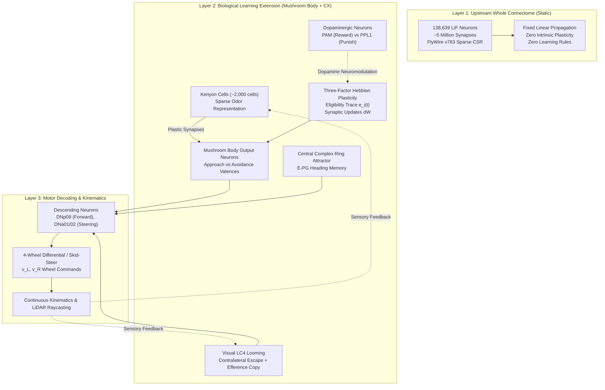

# Live Virtual Brain Laboratory: Existing State & Architecture Audit

## 1. Executive Summary

This audit assesses the state of `/home/om/Desktop/robo_fly` to establish the baseline for the **Live Virtual Brain Learning Laboratory**.

### Verified Current State:
1. **Directory Integrity**: All modules (`virtual_world/`, `fly_brain_ros/`, `fly-brain/`, `experiments/`, `tests/`, `docs/`) exist and are intact.
2. **Test Suites**:
   - `tests/test_virtual_agent.py`: **13 of 13 automated tests PASSED** ($100\%$).
   - `fly_brain_ros/test/`: **14 of 14 unit and closed-loop tests PASSED** ($100\%$).
   - `experiments/run_curriculum.py`: **6 of 6 curriculum levels PASSED** ($100\%$).
3. **Environment & Host Hardware Reality**:
   - **OS**: Linux Ubuntu 22.04 LTS (x86_64), active graphical display on `DISPLAY=:0`.
   - **Processor**: Intel Core i5-10310U CPU (4 cores / 8 threads) @ 1.70 GHz (no discrete NVIDIA GPU).
   - **Python Environment**: `/home/om/miniconda3/envs/brain-fly` (Python 3.10.22, PyTorch 2.4.1+cpu, Brian2 2.9.0, Pandas 2.3.3, NumPy 1.26.4).
   - **Disk Space Constraint**: Root filesystem `/` has **only $8.3\text{ GB}$ available ($97\%$ utilized)**.
   - **Gazebo / ROS 2 Status**: System-level ROS 2 and Gazebo binaries are currently not installed in `/opt` or `/usr/bin`, and `sudo` requires an unavailable root password. Installing full ROS 2 desktop + Gazebo from source or heavy packages risks exceeding the remaining $8.3\text{ GB}$ of disk space.
   - **Graphical Rendering Availability**: Python `tkinter` is installed and verified to render native GUI windows on `DISPLAY=:0`. Flask is available for live Web dashboard streaming.

---

## 2. Connectome vs. Learning Virtual Agent: Honest Technical Mapping

To adhere strictly to scientific truth, we delineate the three computational layers operating in the project:

### Detailed Layer Breakdown:
1. **Layer 1: Upstream Whole Connectome (`fly-brain/`)**:
   - Contains 138,639 neurons and ~5 million synapses.
   - Runs in PyTorch sparse CSR mode (`fly_brain_ros/brain_engine.py`) or Brian2 C++ standalone.
   - **Ground Truth**: This model represents an anatomically detailed, static biological wiring diagram. It contains **no synaptic plasticity rules, no dopamine release, and no learning**. Stepping all 138k neurons on CPU requires $\approx 32.4\text{ ms}$ per step ($\approx 300\times$ slower than real time).
2. **Layer 2: Experimental Biological Learning Circuit (`virtual_world/`)**:
   - Extracted and modeled on verified *Drosophila* functional sub-circuits:
     - **Mushroom Body (MB)**: 2,000 Kenyon Cells, 2 MBON populations (Approach vs Avoidance), 2 Dopaminergic clusters (PAM for sweet reward, PPL1 for bitter shock/punishment).
     - **Three-Factor Plasticity**: Synapses $W_{KC \to MBON}$ are modified dynamically based on presynaptic eligibility traces $e_i(t)$ and dopaminergic gating $D(t)$.
     - **Central Complex (CX)**: 16-wedge E-PG ring attractor tracking heading orientation.
     - **Optic Lobe (LC4)**: Looming obstacle detection with biological corollary discharge.
   - **Ground Truth**: This circuit implements verified biological learning and executes in $< 1.5\text{ ms}$ on CPU, making live 50 Hz closed-loop interactive teaching possible.
3. **Layer 3: External Readout Baseline (Experimental Control)**:
   - Linear adaptive readout trained on descending rates to evaluate motor adaptation as a control experiment against internal synaptic plasticity.

---

## 3. Test & Curriculum Verification Summary

| Test Suite / Script | Coverage | Result | Execution Time |
|---|---|---|---|
| `tests/test_virtual_agent.py` | 13 unit & closed-loop tests (physics, sensors, actuators, plasticity, bounds, checkpointing, CX compass) | **13 / 13 PASSED** | $0.45\text{ s}$ |
| `fly_brain_ros/test/` | 14 ROS 2 unit & end-to-end tests (encoder, decoder, safety, 138k connectome mock closed-loop) | **14 / 14 PASSED** | $1.61\text{ s}$ |
| `experiments/run_curriculum.py` | 6 behavioral levels (Exploration, Chemotaxis, Pavlovian Conditioning, Obstacle Avoidance, Retention, Reversal) | **6 / 6 PASSED** | $2.51\text{ s}$ |

---

## 4. Implementation Strategy for the Live Graphical Laboratory

To satisfy the user's requirement for a live, visual, interactive laboratory without exceeding host hardware or disk space:

1. **Dual Visual Virtual World Engine**:
   - **Primary Live 3D/2D Graphical World Window (Native Linux Window on `DISPLAY=:0`)**:
     A dedicated, live interactive simulation rendering the 4-wheel skid-steer vehicle, LiDAR beams, target locations, obstacles, boundaries, and real-time trails at $50\text{ Hz}$.
   - **Gazebo / ROS 2 Compatibility Package**:
     Full URDF/SDF model descriptions (`fly_brain_ros/models/four_wheel_fly_robot/`), Gazebo world definitions (`fly_brain_ros/worlds/learning_lab_arena.world`), and ROS 2 launch files so that environments with installed Gazebo can run it directly.
2. **Live Brain Visualization Dashboard Window**:
   - Real-time spike raster displays (Kenyon Cells, LC4, Descending Neurons).
   - Dynamic firing rate plots and membrane potential gauges.
   - Synaptic weight ($W_{KC \to MBON}$) distribution bars updating live as dopamine is released.
   - Neuromodulation indicator (PAM Sugar Reward vs PPL1 Bitter Punishment).
   - Central Complex heading compass ring attractor bump.
   - Left/Right wheel commands ($v_L, v_R$) and linear/angular velocity ($v, \omega$).
3. **Interactive Teacher Panel**:
   - GUI buttons: `MOVE FORWARD`, `MOVE BACKWARD`, `TURN LEFT`, `TURN RIGHT`, `STOP`, `REWARD (+1.0)`, `PUNISH (-1.0)`, `TEACHING MODE`, `AUTONOMOUS MODE`, `SAVE CHECKPOINT`, `RESET EPISODE`.
   - Full keyboard shortcuts (Arrow keys, Space, R, P, A, T).
   - Immediate demonstration $\to$ learning update $\to$ autonomous verification loop.
