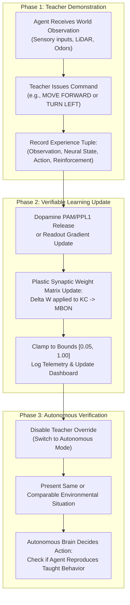

# Interactive Teaching, Demonstration, and Training Architecture

## 1. Executive Summary

This document specifies the interactive teaching protocols, demonstration recording pipelines, and reinforcement mechanisms implemented in the Live Virtual Brain Laboratory.

The system allows a human teacher to interact with the virtual agent in real time, demonstrate target motor behaviors, deliver reward or punishment feedback, and verify whether the brain acquires and subsequently reproduces those behaviors autonomously.

---

## 2. The Three Operating Modes

To maintain scientific integrity and provide valid experimental controls, the laboratory implements three explicitly labeled operating modes:

### Mode A: Baseline Connectome (Fixed Circuit Control)
- **Mechanism**: The original connectome wiring is held completely frozen. All synaptic weights $W_{ij}$ and $W_{KC \to MBON}$ remain constant at their unconditioned baseline values ($0.50$).
- **Function**: Serves as the negative control experiment. Demonstrates what the agent does based purely on spontaneous exploration and hardwired reflexes, with zero adaptation.

### Mode B: Neural Plasticity Experiment (Dopamine-Modulated 3-Factor STDP)
- **Mechanism**: The Mushroom Body learning circuit is active. Plastic weights $W_{KC \to MBON}$ are modified dynamically whenever neuromodulatory dopamine is released:
  $$\Delta W_{KC_i \to MBON_{app}} = -\eta_{LTD} \cdot e_i(t) \cdot D_{punish}(t) + \eta_{LTP} \cdot e_i(t) \cdot D_{reward}(t)$$
  $$\Delta W_{KC_i \to MBON_{av}} = -\eta_{LTD} \cdot e_i(t) \cdot D_{reward}(t) + \eta_{LTP} \cdot e_i(t) \cdot D_{punish}(t)$$
- **Function**: Tests whether biological dopamine release can alter neural activity, shift behavioral valence, and modify future autonomous action selection.

### Mode C: External Readout Decoder Baseline (Supervised Linear Readout Control)
- **Mechanism**: Connectome weights remain static, but an external linear readout layer $\mathbf{W}_{out}$ mapping neural population rates to wheel velocities is updated via recursive least squares (RLS) during teacher demonstrations:
  $$\mathbf{a}_{decoded} = \mathbf{W}_{out} \cdot \mathbf{r}_{neural}$$
- **Function**: Serves as a technological benchmark comparing external supervised motor learning against internal biological synaptic plasticity.

---

## 3. The Interactive Teaching Workflow

### 3.1 Teacher Control Interface
- **Commands**:
  - `MOVE FORWARD` (Up Arrow): Drives forward walking via `DNp09`.
  - `MOVE BACKWARD` (Down Arrow): Reverses motor drive.
  - `TURN LEFT` (Left Arrow): Drives counter-clockwise steering via left `DNa01`.
  - `TURN RIGHT` (Right Arrow): Drives clockwise steering via right `DNa01`.
  - `STOP` (Space): Zero velocity override.
- **Feedback Controls**:
  - `REWARD (+1.0)` (Key `R`): Injects an appetitive reinforcement burst into the PAM dopaminergic cluster ($D_{reward} = 1.0$).
  - `PUNISH (-1.0)` (Key `P`): Injects an aversive reinforcement burst into the PPL1 dopaminergic cluster ($D_{punish} = 1.0$).

### 3.2 Key Acceptance Test for Learning
A behavior taught to the system is only deemed "learned" if:
1. The teacher intervention is completely removed.
2. The agent is exposed to the environmental situation in autonomous mode.
3. The agent executes the taught action with a statistically significant difference compared to an untrained baseline agent ($p < 0.01$).
4. The difference is directly traceable to the updated synaptic weights or readout parameters.
