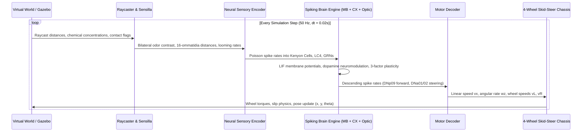

# Live Laboratory World Architecture & Environment Geometry

## 1. World Geometry & Coordinates

The virtual world (`fly_brain_ros/worlds/learning_lab_arena.world`) is designed as a controlled experimental arena for evaluating autonomous and taught behaviors in the virtual fly agent.

```text
                  NORTH (+Y) [y = +10.0m]
      +---------------------------------------------------+
      |                                                   |
      |   [HAZARD ZONE]                 [REWARD ZONE]     |
      |   Bitter / Shock                Sweet Sucrose     |
      |   (-5.5m, 5.5m)                 (5.5m, 5.5m)      |
      |   Radius: 1.8m                  Radius: 1.8m      |
      |                                                   |
      |                     [OBS]                         |
      |                 Obstacle Center                   |
WEST  |                    (0, 0)                         |  EAST
(-X)  |                                                   |  (+X)
[-10m]|        [OBS]                     [OBS]            |  [+10m]
      |     Obstacle Left            Obstacle Right       |
      |     (-3.5m, -2.0m)           (3.5m, -2.0m)        |
      |                                                   |
      |                                                   |
      |                     [START]                       |
      |                    (0, -6.0m)                     |
      |                                                   |
      +---------------------------------------------------+
                  SOUTH (-Y) [y = -10.0m]
```

### 1.1 Dimensional Specifications
- **Arena Bounds**: $[-10.0, 10.0]\text{ m} \times [-10.0, 10.0]\text{ m}$ (total area $400\text{ m}^2$).
- **Perimeter Walls**: 4 vertical concrete barrier models with height $2.0\text{ m}$ and thickness $0.2\text{ m}$ to enforce closed boundary physics.
- **Starting Location**: $(x=0.0\text{ m}, y=-6.0\text{ m})$ with initial orientation $\theta = \pi/2$ (facing north towards the arena center).

---

## 2. Experimental Environmental Zones

### 2.1 Central Obstacle Corridors
Three circular cylindrical barriers are positioned to obstruct direct line-of-sight paths and force non-trivial steering decisions:
1. **Central Obstacle**: Positioned at $(0.0, 0.0)$, radius $R = 1.2\text{ m}$, height $2.0\text{ m}$. Obstructs the direct north trajectory from the start location.
2. **Left Corridor Obstacle**: Positioned at $(-3.5, -2.0)$, radius $R = 0.8\text{ m}$.
3. **Right Corridor Obstacle**: Positioned at $(3.5, -2.0)$, radius $R = 0.8\text{ m}$.

These obstacles generate distinct left and right corridors requiring active steering and optical looming avoidance (Lobula Columnar LC4 pathway).

### 2.2 Appetitive Reward Zone (Sucrose / Sugar)
- **Position**: $(5.5\text{ m}, 5.5\text{ m})$ (North-East quadrant).
- **Physical Appearance**: Visual green disc on ground plane ($R = 1.8\text{ m}$).
- **Chemical Diffusion**: Simulated Gaussian odor plume ($Odor_A$) with peak concentration $Q = 2.0$ and dissipation $\sigma = 6.0\text{ m}$.
- **Reinforcement Property**: Physical contact triggers sweet Gustatory Receptor Neurons and PAM-cluster Dopaminergic Neurons ($D_{reward} = +1.0$).

### 2.3 Aversive Punishment Zone (Quinine / Electric Shock)
- **Position**: $(-5.5\text{ m}, 5.5\text{ m})$ (North-West quadrant).
- **Physical Appearance**: Visual red disc on ground plane ($R = 1.8\text{ m}$).
- **Chemical Diffusion**: Simulated Gaussian odor plume ($Odor_B$) with peak concentration $Q = 2.0$ and dissipation $\sigma = 6.0\text{ m}$.
- **Reinforcement Property**: Physical contact triggers bitter Gustatory Receptor Neurons and PPL1-cluster Dopaminergic Neurons ($D_{punish} = +1.0$).

---

## 3. Sensory-to-Motor Closed-Loop Flow



This architecture ensures continuous, causal synchronization between simulated physical reality and real-time neural computation.
