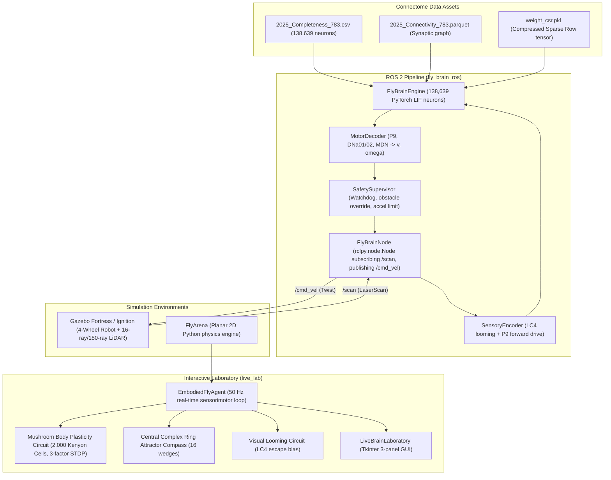

# Phase 1 Audit: Fly-Brain ROS 2 ↔ Gazebo Integration

## 1. Architectural Overview & Source of Truth

This audit analyzes the current implementation across all modules in `fly_brain_ros/`, `live_lab/`, and `virtual_world/` to trace how connectome data, sensory encoding, neural stepping, motor decoding, and simulation environments operate.

---

## 2. Detailed Inspection of Existing Files

### 2.1 `fly_brain_ros/fly_brain_node.py`
- **Current State**: Implements `FlyBrainControllerPipeline` with an asynchronous worker thread (`_worker_loop`) and bounded queues (`input_queue`, `output_queue`).
- **Deficiencies Identified**:
  1. It is **not** a real `rclpy.node.Node`. It does not import `rclpy`, does not subscribe to `/scan`, and does not publish to `/cmd_vel`.
  2. The `main()` entry point executes an artificial 5-cycle console loop feeding hardcoded mock ranges `(3.0, 3.0, 3.0)` via `pipeline.handle_sensor_ranges(3.0, 3.0, 3.0)`.
  3. No ROS parameter declaration or retrieval is implemented.

### 2.2 `fly_brain_ros/brain_engine.py`
- **Current State**: Implements `FlyBrainEngine` using PyTorch sparse CSR tensors.
- **Verification**: Verified that it loads 138,639 neurons from `fly-brain/data/weight_csr.pkl` in $0.28\text{ s}$ on host CPU, and advances biological time using `PoissonSpikeGenerator`, `AlphaSynapse`, and `LIFNeuron`.
- **Latency**: $10$ steps ($1.0\text{ ms}$ simulated time) takes $\approx 215\text{ ms}$ on host Intel Core i5 CPU.

### 2.3 `fly_brain_ros/sensory_encoder.py`
- **Current State**: Maps left, right, and front obstacle distances into Poisson spike frequencies (Hz) injected into:
  - 12 Left LC4 lobula columellar neurons (`LC4_IDS_LEFT`)
  - 12 Right LC4 lobula columellar neurons (`LC4_IDS_RIGHT`)
  - 2 P9 forward walking driver neurons (`P9_LEFT`, `P9_RIGHT`).
- **LaserScan Sectoring**: Divides scans into Front ($[-15^\circ, +15^\circ]$), Left ($[0^\circ, +60^\circ]$), and Right ($[-60^\circ, 0^\circ]$).
- **Need**: Must handle invalid range inputs (`inf`, `nan`, ranges outside `[range_min, range_max]`).

### 2.4 `fly_brain_ros/motor_decoder.py`
- **Current State**: Monitors 8 descending neurons:
  - `P9_ODN1_LEFT`, `P9_ODN1_RIGHT` $\to$ forward linear speed $v_x$ ($k_v = 0.02$).
  - `DNA01_LEFT`, `DNA02_LEFT`, `DNA01_RIGHT`, `DNA02_RIGHT` $\to$ turning yaw rate $\omega_z$ ($k_w = 0.03$).
  - `MDN_1`, `MDN_2` $\to$ startle/backward crawl velocity ($k_{rev} = 0.02$).
- **Wheel Kinematics**: Maps $v_x$ and $\omega_z$ onto 4-wheel skid-steer chassis ($b = 0.36\text{ m}$, $r = 0.085\text{ m}$):
  $$v_L = v_x - \frac{\omega_z b}{2}, \quad v_R = v_x + \frac{\omega_z b}{2}$$

### 2.5 `fly_brain_ros/safety_supervisor.py`
- **Current State**: Multi-rule safety validation:
  1. `EMERGENCY_STOP` latch.
  2. `INITIALIZING` readiness gate.
  3. `FAULT_STALE_SENSOR`: Triggered if sensor updates cease for $> 0.5\text{ s}$.
  4. `FAULT_BRAIN_TIMEOUT`: Triggered if brain worker halts for $> 0.5\text{ s}$.
  5. `FAULT_INVALID_VALUES`: Guards against `nan` and `inf`.
  6. `SAFETY_OVERRIDE_OBSTACLE`: Immediate zero-velocity/reverse override when obstacle $< 0.25\text{ m}$.
  7. Acceleration rate limiting ($a_{max} = 1.0\text{ m/s}^2$).
  8. Velocity saturation ($v_{max} = 0.4\text{ m/s}, \omega_{max} = 1.0\text{ rad/s}$).

### 2.6 Gazebo Model & World Assets
- **`fly_brain_ros/models/four_wheel_fly_robot/model.sdf`**:
  - Currently written for **Gazebo Classic**: uses `libgazebo_ros_ray_sensor.so` and `libgazebo_ros_diff_drive.so`.
  - Must be migrated to **Gazebo Fortress** (`ignition-gazebo-diff-drive-system`, `ignition-gazebo-sensors-system`, and modern SDF 1.8).
- **`fly_brain_ros/worlds/learning_lab_arena.world`**:
  - Uses Classic world syntax; missing Fortress world system plugins (`Physics`, `Sensors`, `UserCommands`, `SceneBroadcaster`).
- **`fly_brain_ros/launch/live_lab_gazebo.launch.py`**:
  - Uses Classic `libgazebo_ros_factory.so` and `gazebo_ros/spawn_entity.py`.
  - Must be migrated to `ros_gz_sim` and `ros_gz_bridge`.

### 2.7 Packaging (`package.xml`, `setup.py`, `setup.cfg`)
- **Missing Marker**: `resource/fly_brain_ros` does not exist on disk, breaking ament discovery.
- **Incomplete `data_files`**: `setup.py` fails to install `worlds/` and `models/` into the package share directory.
- **Hardcoded Paths**: `config/fly_brain_params.yaml` hardcodes absolute path `/home/om/Desktop/robo_fly`.

---

## 3. Comparison: GUI Neural Model vs. ROS Neural Controller

A critical architectural distinction exists between the GUI's neural runtime and the proposed ROS controller:

| Attribute | Interactive Laboratory (`live_lab`) | ROS 2 Controller (`fly_brain_ros`) |
| :--- | :--- | :--- |
| **Primary Scope** | Associative learning, memory retention, dynamic teaching | Whole-connectome sensorimotor obstacle avoidance |
| **Neural Substrate** | 2,000 Kenyon Cells + MBONs + Central Complex ring attractor | Complete adult connectome (138,639 LIF neurons) |
| **Plasticity** | Dopamine-modulated 3-factor Hebbian STDP (PAM/PPL1) | Fixed synaptic connectivity matrix (`weight_csr.pkl`) |
| **Simulation Step Rate** | Real-time **50.0 Hz** ($20\text{ ms}$ real-world / $20\text{ ms}$ sim time) | Batch cycle **$\sim 4.6\text{ Hz}$** ($215\text{ ms}$ per 10-step cycle on CPU) |
| **Sensory Input** | 16-ray LiDAR, bilateral antennae odor gradients, taste | 180-ray LiDAR sectoring (left, right, front) |
| **Motor Output** | Skid-steer $v_L, v_R$ derived from biological steering bias | Skid-steer $v_L, v_R$ decoded from biological DNs |

### Architectural Decision:
1. **Preserve both models**: The 138k connectome cannot run at 50 Hz on host CPU ($215\text{ ms}$ per cycle), whereas the 2,000-KC Mushroom Body model allows instant interactive teaching and real-time visualization at 50 Hz.
2. **Telemetry Bridge**: We will add a telemetry publishing and shared-state interface so that the ROS node can publish live brain diagnostics (`/fly_brain/telemetry`) and the dashboard can optionally render telemetry directly from the active ROS 2 / Gazebo controller.
