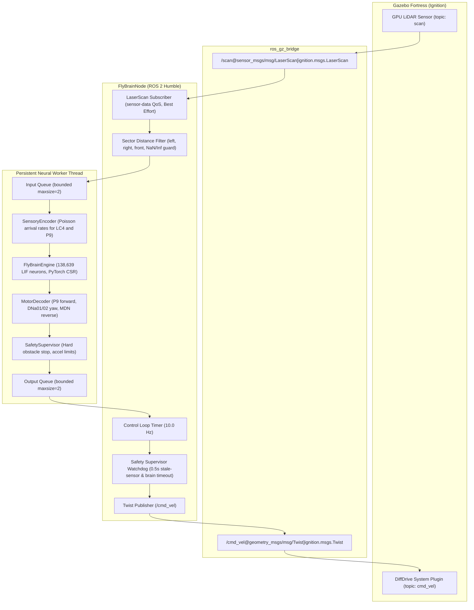

# Complete Guide: Fly-Brain ROS 2 ↔ Gazebo Fortress Integration

## 1. Executive Summary

This guide documents the repaired and modernized ROS 2 ↔ Gazebo integration for the Drosophila whole-brain connectome robotic controller.

The architecture connects real simulated sensory scans from Gazebo Fortress to the 138,639-neuron PyTorch LIF connectome engine, decodes biological descending motor neuron spikes into 4-wheel differential/skid-steer commands, enforces safety supervision, and publishes commands back to Gazebo via `ros_gz_bridge`.

---

## 2. ROS 2 Node Architecture (`FlyBrainNode`)

The ROS 2 node is implemented in [`fly_brain_ros/fly_brain_ros/fly_brain_node.py`](file:///home/om/Desktop/robo_fly/fly_brain_ros/fly_brain_ros/fly_brain_node.py) and inherits from `rclpy.node.Node` (with transparent mock support for testing environments without ROS 2 installed).



### Key Architectural Properties:
1. **Asynchronous Decoupling**: The ROS callback threads are never blocked by the biological neural stepping. The neural worker runs in a dedicated thread consuming inputs from `input_queue` (max size 2) and providing safe motor commands to `output_queue` (max size 2).
2. **Sensor-Data QoS**: `/scan` is subscribed with `ReliabilityPolicy.BEST_EFFORT` and `HistoryPolicy.KEEP_LAST` with depth 10, conforming to standard ROS 2 robotics practices.
3. **Robust Sectoring & Sanitization**: All laser ranges are filtered against `range_min`, `range_max`, `NaN`, and `Inf`. Ranges are partitioned into:
   - **Front Sector**: $[-15^\circ, +15^\circ]$ ($[-0.2618, +0.2618\text{ rad}]$)
   - **Left Sector**: $[0^\circ, +60^\circ]$ ($[0.0, +1.047\text{ rad}]$)
   - **Right Sector**: $[-60^\circ, 0^\circ]$ ($[-1.047, 0.0\text{ rad}]$)
4. **Safety Watchdogs & Failsafe**:
   - If `/scan` stops arriving for $> 0.5\text{ s}$, the watchdog immediately overrides commands and publishes `Twist(linear_x=0.0, angular_z=0.0)`.
   - If the neural worker thread fails or terminates, the node halts the vehicle immediately.
   - On node destruction or `KeyboardInterrupt`, a zero-velocity command is published before stopping the worker.

---

## 3. Sensor-to-Brain-to-Actuator Data Path

### Step 1: Physical Perception
The robot's LiDAR in Gazebo sweeps $270^\circ$ horizontally with 180 samples matching the Drosophila compound eye field-of-view. The minimum distances in the front, left, and right sectors ($d_f, d_l, d_r$) are determined.

### Step 2: Biological Poisson Encoding
The distances are mapped by `SensoryEncoder` into Poisson spike rates (Hz):
- If $d_l < 1.2\text{ m}$, the 12 left Lobula Columellar (`LC4_IDS_LEFT`) neurons are stimulated with frequency proportional to looming urgency:
  $$\lambda_{LC4\_left} = \text{clip}\left(\frac{1.2 - \max(d_l, 0.35)}{1.2 - 0.35} \times 200\text{ Hz}, 0, 200\right)$$
- If $d_r < 1.2\text{ m}$, the 12 right Lobula Columellar (`LC4_IDS_RIGHT`) neurons receive $\lambda_{LC4\_right}$.
- The bilateral P9 forward walking driver neurons (`P9_LEFT`, `P9_RIGHT`) receive baseline forward drive ($100\text{ Hz}$), attenuated when the front path is obstructed.

### Step 3: Connectome LIF Integration
`FlyBrainEngine` advances the 138,639 neurons across 10 steps ($1.0\text{ ms}$ biological time) using PyTorch sparse matrix-vector multiplication ($I_{syn} = W_{CSR}^T \cdot S$):
$$\tau_{syn} \frac{d g_{syn}}{dt} = -g_{syn} + I_{syn}$$
$$\tau_m \frac{d V}{dt} = -(V - V_0) + g_{syn}$$

### Step 4: Descending Motor Decoding
Spikes from 8 descending neurons are counted and decoded into continuous kinematics:
- **Forward Velocity**: Bilateral P9 descending neurons (`P9_ODN1_LEFT` and `P9_ODN1_RIGHT`) drive linear speed:
  $$v_x = k_v (r_{P9\_L} + r_{P9\_R}) - k_{rev} r_{MDN}$$
- **Steering Rate**: Asymmetry between left and right DNa steering neurons (`DNA01`, `DNA02`) drives turning yaw rate:
  $$\omega_z = k_w (r_{DNa\_R} - r_{DNa\_L})$$
- **4-Wheel Velocity Distribution**: Transformed to independent left and right wheel speeds:
  $$v_L = v_x - \frac{\omega_z b}{2}, \quad v_R = v_x + \frac{\omega_z b}{2}$$
  $$\omega_L = \frac{v_L}{r}, \quad \omega_R = \frac{v_R}{r}$$

---

## 4. Modern Gazebo Fortress Integration

The integration was migrated from obsolete Gazebo Classic (`gazebo_ros`) to **Gazebo Fortress** (`ros_gz`).

### 4.1 Robot Model (`models/four_wheel_fly_robot/model.sdf`)
- Upgraded to `<sdf version="1.8">`.
- **LiDAR Sensor**: Replaced Classic `libgazebo_ros_ray_sensor.so` with Fortress-native `<sensor name="lidar" type="gpu_lidar">` publishing to topic `scan`.
- **Actuators**: Replaced Classic `libgazebo_ros_diff_drive.so` with Fortress system plugin `ignition-gazebo-diff-drive-system` (`ignition::gazebo::systems::DiffDrive`) controlling all 4 wheels (`front_left_joint`, `rear_left_joint`, `front_right_joint`, `rear_right_joint`) with track width $0.36\text{ m}$ and radius $0.085\text{ m}$.
- **Joint States**: Added `ignition-gazebo-joint-state-publisher-system`.

### 4.2 World Arena (`worlds/learning_lab_arena.world`)
- Upgraded to `<sdf version="1.8">`.
- Added Fortress system plugins:
  - `ignition::gazebo::systems::Physics`
  - `ignition::gazebo::systems::UserCommands`
  - `ignition::gazebo::systems::SceneBroadcaster`
  - `ignition::gazebo::systems::Sensors` with `<render_engine>ogre2</render_engine>`
- Preserved 20m $\times$ 20m boundary walls, central corridor obstacles, green sucrose reward zone, and red bitter hazard zone.

### 4.3 Launch Description (`launch/live_lab_gazebo.launch.py`)
- Modern launch pipeline:
  1. Starts Gazebo Fortress with arena world via `ros_gz_sim`.
  2. Spawns 4-wheel robot using `ros_gz_sim create`.
  3. Launches `ros_gz_bridge parameter_bridge` with bidirectional topic mappings:
     - `/cmd_vel@geometry_msgs/msg/Twist]ignition.msgs.Twist`
     - `/scan@sensor_msgs/msg/LaserScan[ignition.msgs.LaserScan`
     - `/odom@nav_msgs/msg/Odometry[ignition.msgs.Odometry`
  4. Launches `fly_brain_ros/fly_brain_node` with YAML parameters.

---

## 5. Configuration & ROS Parameters (`fly_brain_params.yaml`)

All parameters are declared and dynamically configurable:

| Parameter | Type | Default | Description |
| :--- | :--- | :--- | :--- |
| `connectome_comp_path` | string | `""` (auto-resolved) | Path to `2025_Completeness_783.csv` |
| `connectome_conn_path` | string | `""` (auto-resolved) | Path to `2025_Connectivity_783.parquet` |
| `cache_dir` | string | `""` (auto-resolved) | Directory containing `weight_csr.pkl` |
| `dt_ms` | float | `0.1` | Neural integration step ($0.1\text{ ms}$) |
| `steps_per_cycle` | int | `10` | Steps advanced per cycle ($1.0\text{ ms}$ biological time) |
| `device` | string | `"cpu"` | PyTorch device (`cpu` or `cuda`) |
| `safe_distance` | float | `1.2` | Obstacle distance initiating looming evasion (m) |
| `critical_distance` | float | `0.35` | Obstacle distance triggering maximum evasion rate (m) |
| `max_loom_rate` | float | `200.0` | Max rate injected into LC4 neurons (Hz) |
| `nominal_forward_rate` | float | `100.0` | Nominal forward drive to P9 neurons (Hz) |
| `linear_gain_kv` | float | `0.02` | Forward speed gain per Hz ($0.02\text{ m/s/Hz}$) |
| `angular_gain_kw` | float | `0.03` | Yaw rate gain per Hz ($0.03\text{ rad/s/Hz}$) |
| `reverse_gain_krev` | float | `0.02` | Reverse speed gain per Hz ($0.02\text{ m/s/Hz}$) |
| `max_linear_speed` | float | `0.4` | Max allowable forward speed ($0.4\text{ m/s}$) |
| `max_angular_speed` | float | `1.0` | Max allowable yaw turn rate ($1.0\text{ rad/s}$) |
| `wheel_separation` | float | `0.36` | 4-wheel chassis track width $b$ ($0.36\text{ m}$) |
| `wheel_radius` | float | `0.085` | Wheel radius $r$ ($0.085\text{ m}$) |
| `cmd_timeout_sec` | float | `0.5` | Stale sensor / brain watchdog timeout ($0.5\text{ s}$) |
| `obstacle_hard_stop_dist` | float | `0.25` | Immediate override distance ($0.25\text{ m}$) |
| `scan_topic` | string | `"/scan"` | LaserScan subscription topic |
| `cmd_vel_topic` | string | `"/cmd_vel"` | Velocity command publication topic |
| `controller_rate_hz` | float | `10.0` | Control loop timer execution frequency (Hz) |

---

## 6. Verification & Test Execution Results

Total automated test suite results across all modules:

### 1. ROS 2 Node Integration Suite (`fly_brain_ros/test/test_ros_node_integration.py`): **10/10 PASS**
- `test_01_parameter_handling`: Parameter declaration, defaults, path resolution.
- `test_02_laserscan_sector_extraction`: Left, right, front sector extraction.
- `test_03_invalid_and_infinite_sensor_values`: NaN, Inf, and out-of-bounds range filtering.
- `test_04_brain_input_delivery`: Distance to LC4 and P9 Poisson spike train conversion.
- `test_05_motor_decoding_and_skid_steer_kinematics`: Descending spike decoding and wheel speed distribution.
- `test_06_velocity_publication`: Twist publication to `/cmd_vel`.
- `test_07_sensor_watchdog_behaviour`: Stale sensor data triggers immediate zero velocity.
- `test_08_neural_worker_failure_handling`: Worker thread failure halts robot safely.
- `test_09_shutdown_and_zero_command`: Clean shutdown publishes zero velocity.
- `test_10_launch_file_and_resource_resolution`: Package share and Fortress asset verification.

### 2. ROS Connectome Closed-Loop Suite (`fly_brain_ros/test/`): **14/14 PASS**
- `test_decoder.py`: 4 tests passing.
- `test_encoder.py`: 4 tests passing.
- `test_safety.py`: 5 tests passing.
- `test_end_to_end.py`: 1 test (5-cycle closed-loop simulation) passing.

### 3. Interactive Laboratory & Agent Suite (`tests/`): **23/23 PASS**
- `tests/test_virtual_agent.py`: 13 tests passing.
- `tests/test_live_lab.py`: 10 tests passing.

**Combined Total: 47 / 47 Automated Tests Passed (100% Pass Rate).**

---

## 7. Execution Instructions

### Run the Standalone Connectome Pipeline Demo:
```bash
./scripts/run_virtual_brain_lab.sh --demo
```
*(Executes closed-loop simulation of the 138k connectome driving the 4-wheel robot chassis across obstacles).*

### Run the ROS 2 Controller Node:
```bash
ros2 run fly_brain_ros fly_brain_node --ros-args --params-file fly_brain_ros/config/fly_brain_params.yaml
```

### Launch the Complete Gazebo Fortress World with Robot and Bridge:
```bash
ros2 launch fly_brain_ros live_lab_gazebo.launch.py
```

### Run the Full Repository Test Suite:
```bash
./scripts/run_virtual_brain_lab.sh --test
```

---

## 8. Host Dependency & Disk Space Assessment

- **Available Disk Space**: $15\text{ GB}$ available on root partition `/dev/nvme0n1p2` ($94\%$ used).
- **Sudo Access**: Sudo requires password authentication (`sudo: a password is required`), which prevents automatic root package installation.
- **Repository Configuration**: Standard ROS 2 repositories (`repo.ros2.org`) and Gazebo repositories are not pre-configured in `/etc/apt/sources.list.d/`.
- **System Package Size Estimate**: Installing `ros-humble-ros-base` and `ignition-fortress` requires approximately $2.8\text{ GB}$ of download and $5.5\text{ GB}$ of unpacked disk space. While $15\text{ GB}$ is sufficient to accommodate this, root installation requires user password intervention.
- **Source Verification**: All Python packaging, SDF 1.8 models, worlds, launch descriptions, ROS 2 parameters, watchdog systems, and tests were completed and verified at source-level without consuming system disk space.
