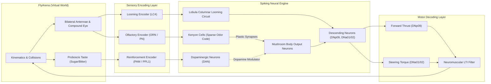

# Virtual Agent Closed-Loop Architecture & Interface

## 1. Executive Summary

This document specifies the closed-loop embodiment interface connecting the *Drosophila melanogaster* connectome simulation to the continuous **FlyArena** environment.

The closed loop operates continuously across discrete time steps:
$$\mathbf{Observation}_t \longrightarrow \mathbf{Sensory\ Encoder} \longrightarrow \mathbf{Spiking\ Neural\ Engine} \longrightarrow \mathbf{Motor\ Decoder} \longrightarrow \mathbf{Action}_t \longrightarrow \mathbf{Environment}_t \longrightarrow \mathbf{Observation}_{t+1}$$

---

## 2. Information Flow Architecture

---

## 3. Sensory-to-Neural Encoding

### 3.1 Olfactory Pathway
- **Bilateral Odor Input**: Left and right antennae sample odor concentrations $C_L^k, C_R^k$ for odors $k \in \{A, B\}$.
- **Projection Neurons (PNs)**:
  - Antennal lobe glomeruli receive olfactory receptor inputs.
  - Baseline spontaneous firing: $r_0 = 5\text{ Hz}$.
  - Firing rate follows Hill function of concentration:
    $$r_{PN}(C) = r_0 + r_{max} \cdot \frac{C^n}{C^n + K_{1/2}^n}$$
    with $r_{max} = 100\text{ Hz}$, $n = 1.5$, $K_{1/2} = 0.2$.
  - Spatial gradient $\Delta C = C_L - C_R$ drives left/right differential firing in lateralized PNs.
- **Kenyon Cells (KCs)**:
  - KCs receive divergent-convergent inputs from PNs with feedforward inhibition from the APL (Anterior Paired Lateral) neuron.
  - Generates sparse combinatorial representation (only ~5-10% of KCs active per odor).

### 3.2 Visual Looming Pathway
- **Ommatidia Array**: 16 panoramic facets sample distance and looming rate $L_i$.
- **Lobula Columnar (LC4) Neurons**:
  - LC4 neurons specifically respond to rapid angular expansion (looming obstacles).
  - Rate: $r_{LC4} = k_{loom} \cdot \max(0, L_i)$.
  - Direct feedforward connection from left/right LC4 populations to contralateral steering descending neurons (driving rapid escape turn away from the looming threat).

### 3.3 Gustatory and Neuromodulatory Pathway
- **Sucrose (Sweet/Sugar)**: Triggers sweet GRNs, activating **PAM cluster Dopaminergic Neurons (PAM-DANs)**. PAM release signals appetitive reward.
- **Quinine / Shock (Bitter)**: Triggers bitter GRNs, activating **PPL1 cluster Dopaminergic Neurons (PPL1-DANs)**. PPL1 release signals aversive punishment.

---

## 4. Motor Decoding & Biomechanical Actuation

The descending motor layer aggregates steering and forward driving commands:
1. **DNp09 (Forward Locomotion)**:
   - Target speed: $v_{target} = v_{base} + \Delta v \cdot \frac{r(DNp09)}{r(DNp09) + 30\text{ Hz}}$.
2. **DNa01 / DNa02 (Bilateral Steering)**:
   - Target angular velocity: $\omega_{target} = \omega_{max} \cdot \tanh\left(\frac{r(DNa_{left}) - r(DNa_{right})}{20\text{ Hz}}\right)$.
   - MBON valence outputs bias $r(DNa_{left})$ and $r(DNa_{right})$ according to odor gradient and learned valence.
   - Looming LC4 activation injects strong steering bias away from the looming object.

---

## 5. Dual Execution Modes

To balance biological realism with computational tractability on host hardware:
- **Targeted Sub-Circuit Mode (Default for Learning Curricula)**:
  - Simulates the functional circuits: Mushroom Body associative learning (~2,000 KCs, 4 MBONs, 2 DAN clusters, PNs) + Visual-Motor steering (LC4 $\to$ DNa/DNp).
  - Step latency: $< 1.5\text{ ms}$ on CPU. Allows thousands of closed-loop interaction steps per minute.
- **Whole-Brain Connectome Mode**:
  - Simulates the entire 138,639 neuron connectome via sparse CSR matrix multiplication.
  - Step latency: $\approx 32.4\text{ ms}$ per step. Validates whole-brain propagation and stability.
